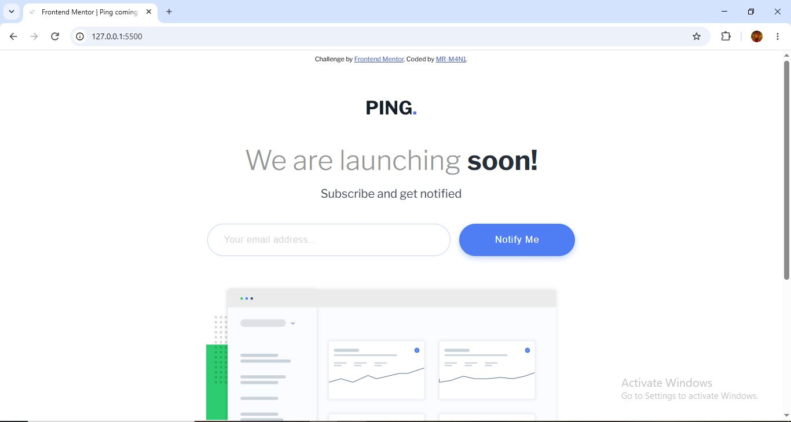
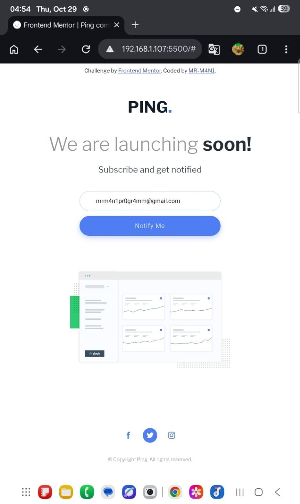
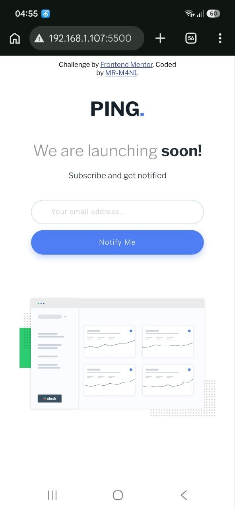
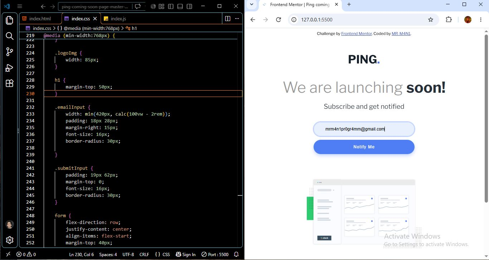

# Ping-coming-soon-page
This is a my solution to the Ping coming soon page challenge on Frontend Mentor
# Frontend Mentor - Ping coming soon page solution

This is a solution to the [Ping coming soon page challenge on Frontend Mentor](https://www.frontendmentor.io/challenges/ping-single-column-coming-soon-page-5cadd051fec04111f7b848da). Frontend Mentor challenges help you improve your coding skills by building realistic projects. 

## Table of contents

- [Overview](#overview)
  - [The challenge](#the-challenge)
  - [Screenshot](#screenshot)
  - [Links](#links)
- [My process](#my-process)
  - [Built with](#built-with)
  - [What I learned](#what-i-learned)
  - [Continued development](#continued-development)
  - [Useful resources](#useful-resources)
  - [AI Collaboration](#ai-collaboration)
- [Author](#author)
- [Acknowledgments](#acknowledgments)

## Overview

### The challenge

Users should be able to:

- View the optimal layout for the site depending on their device's screen size
- See hover states for all interactive elements on the page
- Submit their email address using an `input` field
- Receive an error message when the `form` is submitted if:
	- The `input` field is empty. The message for this error should say *"Whoops! It looks like you forgot to add your email"*
	- The email address is not formatted correctly (i.e. a correct email address should have this structure: `name@host.tld`). The message for this error should say *"Please provide a valid email address"*

### Screenshot






### Links

- Solution URL: [Frontend Mentor Solution](https://github.com/MR-M4N1/Ping-coming-soon-page)
- Live Site URL: [Live Demo](https://mr-m4n1.github.io/Ping-coming-soon-page/)

## My process



### Built with

- Semantic HTML5
- CSS3
- Flexbox
- Responsive Web Design
- CSS Media Queries
- CSS Custom Properties
- JavaScript
- Mobile first

### What I learned

- Responsive typography with clamp(): 
I learned how to make text resize smoothly based on the viewport width while keeping it within a minimum and maximum size.

```css
h1 {
  font-size: clamp(22px, 3.5vw, 47px);
}
```

- HTML form validation with novalidate:
 I learned how the novalidate attribute disables the browser's built-in form validation when submitting a form, allowing custom validation logic to handle the process instead.

```html
<form novalidate>
  <input type="email" required>
  <button type="submit">Subscribe</button>
</form>
```

### Continued development

- CSS maintainability: Keep refining my CSS structure, reusable custom properties, and responsive styles to make future projects easier to maintain.

- Form validation: Practice implementing custom form validation with JavaScript, including handling invalid email addresses and displaying clear error messages.

### Useful resources

- [SVG Repo](https://www.svgrepo.com/) - This site helped me find some amazing icons. I really liked it and will continue using it in future projects.

### AI Collaboration

I used AI tools to review my code, identify potential issues, and better understand responsive design techniques such as clamp() and CSS media queries. AI also helped me understand HTML form validation and improve the overall quality and maintainability of my code.

## Author

- Frontend Mentor - [@MR-M4N1](https://www.frontendmentor.io/profile/MR-M4N1)
- Pinterest - [@MR-M4N1](https://www.pinterest.com/mrm4n1/?invite_code=4dc73b0e43814c3395c2f9600625eb5d&sender=1093671228168293050)
- LinkedIn - [@mani-ghorbanian](https://www.linkedin.com/in/mani-ghorbanian-351820327/)


## Acknowledgments

Thanks to Frontend Mentor for providing this challenge and the design resources that helped guide my implementation.
